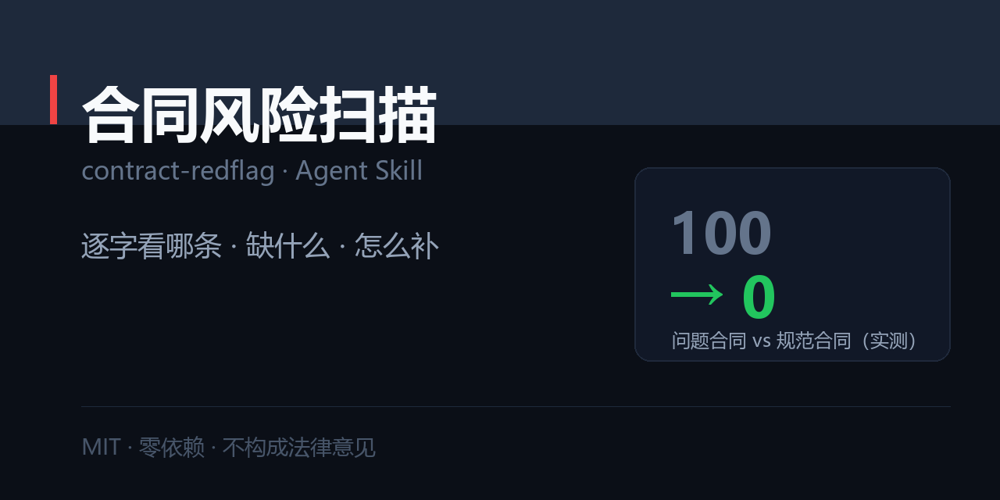

# 合同条款风险扫描 · contract-redflag

> 租房、劳动合同里哪几条要逐字看，哪些本该有却没写。给出风险分、原文定位、可直接抄的补充条款。



[](./SKILL.md)
[](./LICENSE)
[](#)

---

## 一句话

```
$ python scripts/scan_contract.py 租房合同.txt --type rent

风险分：100/100    风险偏高：签字前至少补 3 条，或换一份格式合同
条款：高危 6 · 中危 6 · 提醒 0   缺失 6 条   （345 个汉字）

【需要逐字看的条款】
  [高危] 「自动续租」
       原文：…租期届满后自动续租一年。三、租金：每月人民币…
  [高危] 「扣除相应费用」
       原文：…如房屋有损坏，甲方有权扣除相应费用后退还…
  [高危] 「按日 5%」
       原文：…逾期支付租金的，按日 5% 计收滞纳金…

【缺失条款（比写了什么更值得警惕）】
  - 押金退还期限：押金拖着不还你拿他没办法
  - 维修责任划分：结构问题丢给你赔
  - 提前解约条件：只能住满，或损失全部押金
```

同一套规则跑一份规范合同：**0 分，零命中，无缺失**。

完整报告见 [`examples/01-rent-contract.md`](./examples/01-rent-contract.md)。

> ⚠️ 本工具只做关键词匹配，**不构成法律意见**。涉及金额较大或已发生争议，请咨询律师或当地法律援助/劳动仲裁机构。

---

## 为什么不是「让 AI 看看这合同有没有坑」

| | 让 AI 读合同 | 用这个 Skill |
| --- | --- | --- |
| 输出 | 「这份合同存在一些风险条款」 | 风险分 + **原文定位** + 建议补充文本 |
| 定位 | 说得含糊，你还得自己找 | 直接给原文片段，翻页就能对上 |
| 缺失检查 | 容易漏 | 单独一栏列出「该有但没有」的条款 |
| 落地 | 说完了你还是不知道怎么改 | 每条配一句**可直接抄进补充协议**的表述 |
| 边界 | 容易给出「该条款无效」这类结论 | 明确声明不构成法律意见，只给「该问什么」 |

## 安装

```bash
git clone https://github.com/zhbehx/contract-redflag.git ~/.claude/skills/contract-redflag
```

## 用法

```bash
python scripts/scan_contract.py 租房合同.txt --type rent     # 租房
python scripts/scan_contract.py 劳动合同.txt --type labor    # 劳动
python scripts/scan_contract.py 协议.txt --type other        # 只查通用陷阱

--explain      每条的风险说明 + 建议补充文本
--json         结构化输出
--fail-over 60 风险分超阈值退出码 1
```

## 两类合同各查什么

**租房**：押金退还期限 · 扣款标准 · 自动续租 · 提前解约 · 维修责任 · 转租 · 水电单价 · 物业费 · 甲方进入条件 · 房屋状况确认

**劳动**：试用期上限 · 工资构成 · 发放日 · 社保基数 · 工时制度 · 加班认定 · 单方调岗 · 解除补偿 · 竞业补偿 · 违约金

**通用**：模糊表述（及时/合理/另行约定）· 单方权利 · 违约范围无边界 · 争议解决 · 变更须书面 · 附件清单

## 三个设计取舍

1. **只标需要逐字看的条款，不做全文点评。** 一份合同真正要精读的通常只有 6–8 条，全篇点评用户看不完也记不住。
2. **缺失条款单独成栏，且权重更高。** 没写押金退还期限，比写了一条不利条款更危险——因为出事时全靠对方解释。
3. **每个风险都配「可直接抄的补充文本」。** 只说「这条不合理」等于没帮上忙。

## 仓库结构

```
contract-redflag/
├── SKILL.md                      # 三条前提 + 六维 + Step 0–5 + 交付格式 + 反模式
├── references/
│   ├── clause-lexicon.md         # 60+ 条风险条款：原文 → 风险 → 建议补充
│   └── missing-clauses.md        # 租房 12 项 + 劳动 10 项缺失清单（含可抄文本）
├── scripts/
│   └── scan_contract.py          # 风险分 / 原文定位 / 缺失检查 / 保护性条款过滤
├── examples/
│   ├── 01-rent-contract.md       # 完整报告
│   └── fixtures/                 # 问题合同 / 规范合同 / 问题劳动合同
└── market/social-preview.png
```

## 三个诚实的局限

1. **只认词，不认法。** 它不知道你所在地区的最新规定，也不判断条款是否真的无效。
2. **截图缺页会导致「缺失」误报。** 尽量给完整文本。
3. **不能替代律师。** 押金超过两个月房租、涉及培训服务期或竞业限制的，花几百块找律师看一遍是划算的。

## 相关 skill

- **内容与写作**：[爆款文案工坊](https://github.com/zhbehx/viral-copy) · [AI 味检测器](https://github.com/zhbehx/ai-tell)
- **职场五件套**：[简历对岗改写](https://github.com/zhbehx/resume-tailor) · [面试陪练](https://github.com/zhbehx/interview-coach) · [汇报写作](https://github.com/zhbehx/weekly-report) · [PPT 叙事大纲](https://github.com/zhbehx/slide-story) · [会议纪要](https://github.com/zhbehx/meeting-actions)
- **避坑与决策**：[JD 红旗检测](https://github.com/zhbehx/jd-redflag) · [会议成本](https://github.com/zhbehx/meeting-cost)
- **发布与沟通**：[隐私自查](https://github.com/zhbehx/privacy-scan) · [职场语气](https://github.com/zhbehx/tone-check)

共同点：零依赖、中文优先、每个都带一个确定性检查脚本。

## 自定义

1. **加你们城市的特殊条款**：`scripts/scan_contract.py` 里 `RENT_RULES` 追加一条正则。
2. **加合同类型**：新增一个 `XXX_RULES` 列表 + `MISSING_XXX`，在 `rules_for` / `missing_for` 里挂上。
3. **调权重**：`LEVEL_PENALTY`（H=15 / M=7 / L=3），缺失条款按 6 分/条计。

## FAQ

**Q：0 分是不是就能放心签？**
A：不是。0 分只代表「没命中已知的坑」。签字前仍要：核对缺失条款、确认附件齐全、保留对方身份信息。

**Q：它说某条无效，是真的吗？**
A：它从不说「无效」。它只说「这条需要逐字看，建议问清」。效力问题必须由律师或仲裁机构判断。

**Q：房东/HR 拒绝改合同怎么办？**
A：这本身就是信息。见 `references/clause-lexicon.md` 最后一节「怎么谈才不撕破脸」——重点不是说服，是通过对方愿不愿意补一句话来判断这笔交易。

## License

[MIT](./LICENSE)

---

本仓库是 [zhbehx 的 Agent Skill 合集](https://github.com/zhbehx) 之一。

觉得有用就点个 ⭐，是我继续加词库、加行业的动力。

<!-- zhbehx-collection-footer -->
